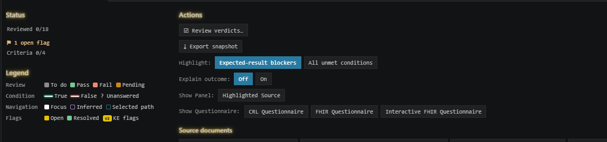
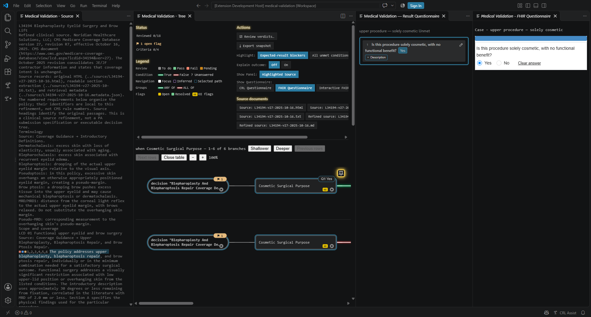
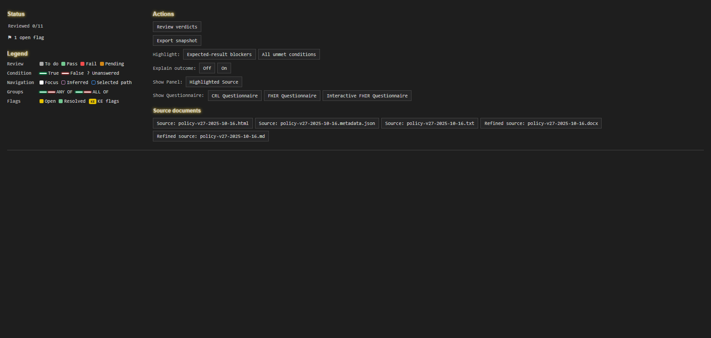
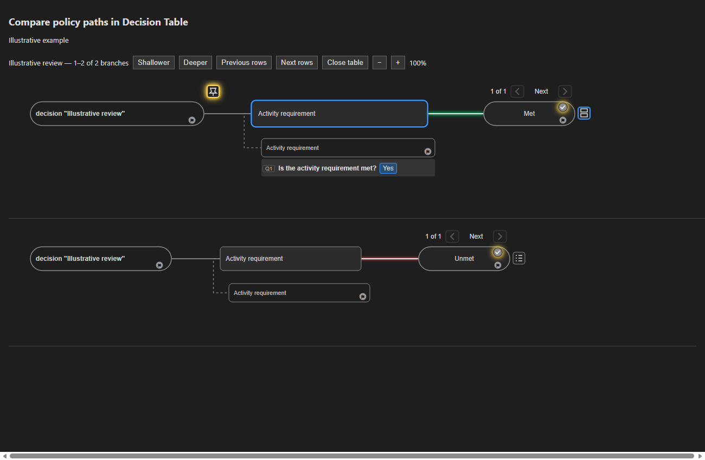
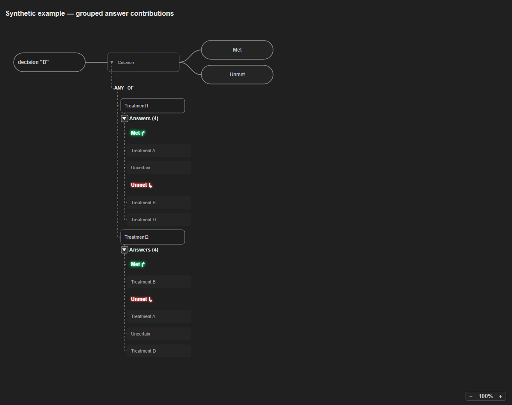
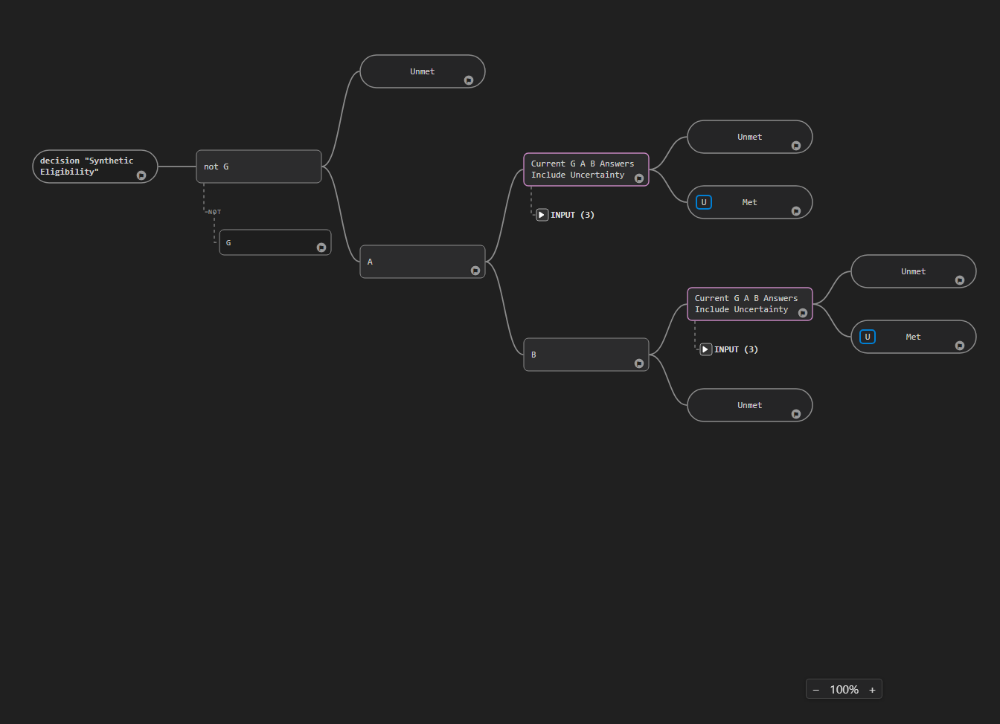

# CRL Release Notes

Updates since CRL 6.4.41 through 6.4.52.

Managed environments provide KALM AI: What's New for the combined Release Notes.

## 6.4.52 — A simpler decision\-tree legend

### Read the condition colors without a second group legend

The legend now focuses on review status, navigation, flags and True/False conditions\. ANY OF and ALL OF labels remain in the tree, where their connector colors follow the selected case and path\.

The condition samples keep their green and red glow\. This view uses a demonstration policy\.

## 6.4.51 — Keep policy review panels in order

### Read the source beside the tree

Highlighted Source opens immediately to the left of the Decision Tree or Decision Table\. The question panels stay to the right, and the tree keeps the remaining space\. You can close and reopen the source panel from Show Panel\.

The source, decision paths and questions remain visible together\. This demonstration uses sample artifacts\.

### Read a simpler group legend

ANY OF and ALL OF each have one glowing line sample\. The duplicate paired lines have been removed\.

## 6.4.50 — A clearer policy review workspace

### Find review controls and policy files

Review actions are grouped together, with status and the legend alongside them\. Open Source and Refined source files directly from their named buttons\. Show Panel lets you open or close Highlighted Source, and Show Questionnaire groups the questionnaire controls\. The legend shows the KE flag badge and the green/red lines used by both ANY OF and ALL OF\.

A fictional example of the review controls and source document buttons\.

### Keep the tree in view

Questionnaire panels and Highlighted Source open at compact, matching widths, leaving the remaining space for the tree or Decision Table\. These defaults return when you reopen the table or use Shallower and Deeper\. Selecting another row keeps your manual width adjustments\.

### See shared review progress across rows

When a branch passes review, its shared steps on the same path also show as passed in other Decision Table rows, including steps before the pin\. Different paths keep their own review colors\. A failed outcome remains failed even when its earlier shared steps passed\.

## 6.4.49 — Explore and compare policy paths

### Compare paths in a Decision Table

Select a node, then click its glowing yellow pin to see its downstream branches stacked in one view\. Use Shallower and Deeper to broaden or narrow the comparison\. Pinning an outcome shows one branch\. Branches without a test case are marked with a coverage error\.

The familiar branch view is repeated for each path\. This example uses fictional questions and answers\.

### Keep questions beside the path you are reviewing

The question\-results icon cycles through a separate panel, questions inside the branch, and off\. The first row opens its question panel automatically\. If you move from a row using the panel to a row with questions switched off, the panel follows you\. The saved FHIR Questionnaire follows the focused row\. Both questionnaires can remain visible beside the tree\. Input groups keep your expand or collapse choice\.

### See which answers feed each path

Expand Answers under a question to see its choices grouped by the path they contribute to\. Each question has its own groups\. The headings use the connector colors and show the next outcome when it is known\. Green and red identify the paths\.

The same answer can contribute to different paths at different checks\. The example is fictional\.

### Show uncertainty checks when you need them

For policies prepared with marked uncertainty checks, the U control inside an outcome node shows or hides the check\. A blue border indicates that it is shown\. Some checks stay visible when needed for the selected case or a review flag\. Showing or hiding changes the view only\.

Use U to inspect the uncertainty check associated with an outcome\.

### Open the policy source documents

Choose Source documents in Medical Validation to list the selected policy's Source and Refined source files\. Select a file to open it in its usual editor, including the document viewers supplied in your workspace\.

### Keep the tree reachable beside a flag

While a flag panel is open, pan farther to bring nodes clear of the panel\. Opening the panel keeps your current position\. Selecting a flag from the flag list can still navigate to its target\.

### A reminder about multiple flags

Already available in 6\.4\.48, a node can hold several flags\. Click its flag icon to choose the flag to read\. To add another, right\-click the node and choose Add flag on the intended target\.

## 6.4.48 — Simpler review flags

### Focus on the review question

The flag view keeps the question, policy quotation, description and review status in view\. Internal classifications and technical identifiers are tucked into Details\.

A fictional example of a question for the reviewer\.

### Compare Before and After

Changes shows Before and After beside the flag's description, without repeating the request in another field\. If a request has not been implemented, the reason stays visible\. Affected questions and evidence links remain available\.

The request and the resulting change stay together for review\.

### Open and close the interactive questionnaire

The Interactive FHIR Questionnaire button turns blue while its tab is open\. Click it again to close the tab, just as you can with FHIR Questionnaire\.

## 6.4.46 — Clearer questions and review flags

### Measurement questions supply their unit

When a measurement question has a specified unit, such as BMI in kg/m2, enter the number and the form supplies the unit\. You can change or clear the answer\.

Illustrative BMI question; no patient information is shown\.

### Read the review question separately

A knowledge engineer can provide a short question and a quotation from the policy separately from the supporting explanation, making it easier to see what needs your review\.

### See what changed after a review request

A flag can include a summary of the earlier wording and the change made, with links to supporting evidence\. You can review the result before marking the flag Fixed or Approved\.

Images and demonstrations use sample artifacts.
