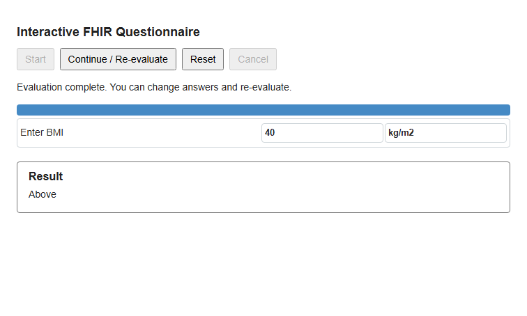
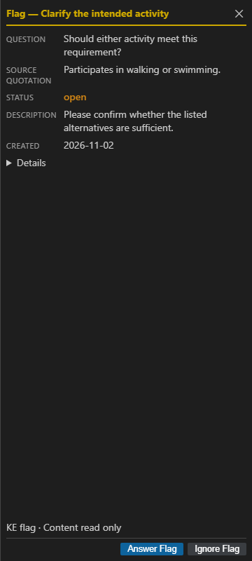
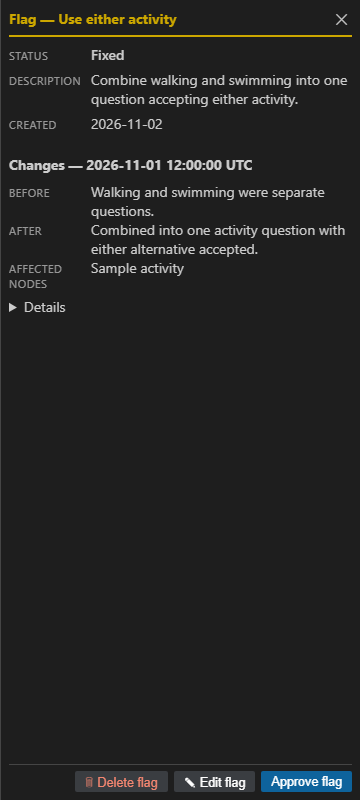

# CRL Release Notes

Updates since CRL 6.4.41 through 6.4.47.

Managed environments provide KALM AI: What's New for the combined Release Notes.

## 6.4.47 — Release notes for the combined KALM view

### One combined place to see what changed

CRL supplies versioned release notes and local illustrations for the combined KALM AI: What's New view\. This view is available in images that include the compatible Spaces launcher, which manages opening and skipped\-release history\. CRL no longer opens a separate notes tab\. Downloadable HTML and Markdown remain available from the release\.

## 6.4.46 — See what's new in CRL

### Quantity questions carry their unit

Declare a unit once on the CRL value type, for example: value type is Quantity 'kg/m2'\. CQL evaluation and the emitted FHIR input profile use that declared unit; the matching $apply engine carries it into the Questionnaire\. Enter a number in the Interactive Questionnaire and the client submits a Quantity in that unit\. Change and clear remain available\. Existing questions without a declared unit keep their prior behavior\.

Synthetic runtime example\. Raw unitless measurements from clients that ignore the unit contract are still rejected; the clinical threshold is authored separately\.

### Read the question and source separately

KE flags can now carry a succinct question, source reference and source quotation in separate fields\. The flag view displays those fields above the description so reviewers can distinguish the question from its supporting text\. Legacy descriptions remain readable\. The KE pipeline must populate the new fields to benefit\.

Synthetic display example using the shipped flag renderer; customer policy content is not shown\.

### See what a rerun reports changing

A rerun can supply structured Before, Requested change, Change made and Affected nodes information, with evidence links\. CRL verifies the referenced artifact evidence when opening it\. These summaries report technical changes and do not automatically approve a flag or establish clinical correctness; the pipeline supplies the report\.

Synthetic display example\. Existing flag review status remains under human control\.

### Bundled illustrated Release Notes

CRL 6\.4\.46 introduced bundled illustrated Release Notes, skipped\-release history and offline media\. Downloadable HTML and Markdown provide the same authored content\.

### Use the matching Quantity\-capable engine

CRL 6\.4\.46 selects engine build cqf\-definition\-dcac972f\-normalized\-cache\-quantity\-units\-20261101, SHA256 2ee7aa8ea7e76b0cf10cac558fc123d4326491087ae905f65b74f9354947b8fa\. Declared\-unit questions require this generator support\. Deployment images must include the matching JAR; explicit runtime overrides must be updated for the new feature\. The normal runtime verifies its configured or cached engine and does not download it\.

## 6.4.45 — Engine dependency security update

### Updated engine dependencies

The normalized\-cache engine updates its packaged Guava runtime to 33\.7\.2\-jre\. Application behavior, the normalized\-cache implementation and driver/worker bytecode remain unchanged\. The release includes a dated full\-JAR dependency scan and immutable engine identity\.

## 6.4.44 — Concurrent evaluation and compilation reuse

### Run independent jobs concurrently

The native runtime supports a configurable pool of reusable JVMs\. Complete sessions keep one owner and execute their steps in sequence\. Nautilus can select six workers; the generic default remains one\. Compilation reuse checks definition content and invalidates on changed artifacts, while clinical evaluation state remains fresh\.

## 6.4.43 — Faster repeated native evaluations

### Reuse the native runtime

Repeated $apply calls in one CRL tool process reuse an owned JVM while clinical repositories and per\-call state remain fresh\. Streaming CLI sessions also support reuse\. Cancellation, timeout or worker failure triggers cleanup before later work; failed evaluations are not replayed automatically\.

## 6.4.42 — Grouped choices in questionnaires

### Present related choices together

Group ordinary Boolean questions under one shared prompt, choose columns and checkbox or radio controls, and retain separate Yes, No and unanswered answers\. Clearing one answer preserves the others\. The same emitted CQL/FHIR gives older supported engines a meaningful prompt for each independent question\. See the synthetic presentation\-choice demo for an optional explanatory description\.

### Use package identity from the manifest

Declare packageId at the package\.json root\. An explicit tool override takes precedence; the older crl\.packageId field remains a fallback when the root field is absent\.

Images and demonstrations use sample artifacts.
